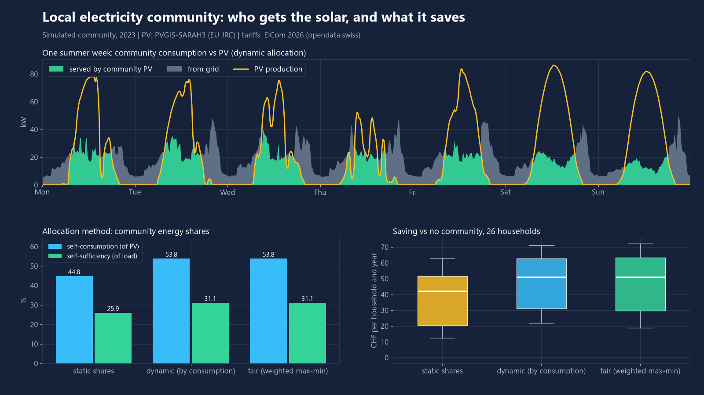
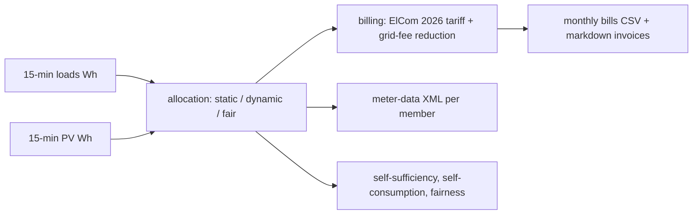

# leg-allocation-sim

Open-source engine that shares building solar between neighbours in a Swiss local electricity community (LEG) or self-consumption group (ZEV/vZEV), bills every member per month and exports the allocation as a meter-data message.



## What it does

- Reads 15-minute smart-meter profiles (Wh per interval) for consumers and PV plants.
- Allocates PV energy to members in every interval with three methods: **static shares**, **dynamic (proportional to consumption)** and **fair (weighted max-min, progressive filling)**. The energy balance `allocated + exported = produced` closes exactly (integer Wh, tested).
- Prices it with real **ElCom 2026 tariffs** (grid usage, energy, levies, grid surcharge) and a grid-fee reduction for community energy, which is a parameter (see "Legal basis").
- Outputs: monthly bill per member (CSV), markdown invoices, producer revenue, community self-sufficiency / self-consumption, savings versus no community, and a **metered-data exchange message** (XML, structure modelled on SDAT-CH / ebIX, see `docs/METER-DATA-EXCHANGE.md`).
- A demo community: 4 buildings, 26 households, 4 businesses, 4 common-area meters (two with a central heat pump), 3 PV owners with 110 kWp (south, east, west roofs).

## Results

All numbers come from `python -m leg_sim demo` (seed 7). The load profiles are **simulated**; PV and tariffs are open data. One simulated year (2023), 35,040 intervals, 34 consumers, tariff of one ElCom operator (id 486, standard product, BFS municipality 101).

Production 118.9 MWh, consumption 205.4 MWh, grid-fee reduction 40 %, community energy price 10.1 Rp/kWh (midpoint between the assumed 8 Rp/kWh feed-in and the 12.1 Rp/kWh energy tariff).

| method | self-consumption of PV | self-sufficiency of load | household saving, median (p10 - p90) CHF/yr | Jain fairness of self-sufficiency |
|---|---:|---:|---:|---:|
| static shares | 44.8 % | 25.9 % | 42 (19 - 58) | 0.920 |
| dynamic | 53.8 % | 31.1 % | 51 (27 - 68) | 0.927 |
| fair (weighted max-min) | 53.8 % | 31.1 % | 51 (27 - 69) | 0.931 |

- Static shares waste PV: a member's unused share is exported even while a neighbour buys from the grid. Dynamic and fair use every usable Wh (9.0 points more self-consumption).
- Dynamic and fair give the same totals. Fair weights each member by its static share and guarantees that share first, then redistributes the unused part; with shares proportional to yearly consumption it differs from dynamic only slightly (fairness index 0.931 vs 0.927).
- Household saving is about 4.5 to 6 % of the electricity bill (median 5.9 % with the fair method). All 34 consumers save under every method. PV owners gain CHF 1,315 per year in total from selling at the community price instead of the feed-in price.
- Total saving of the 34 consumers: CHF 2,963 (dynamic).

Sensitivity (dynamic allocation, same loads):

| assumption changed | grid-fee reduction | household median saving CHF/yr | all consumers CHF/yr |
|---|---:|---:|---:|
| base case | 40 % | 51 | 2,963 |
| two transformer stations in the community | 20 % | 36 | 2,016 |
| reduction applies to the whole grid-usage tariff | 40 % | 55 | 3,174 |
| community billing fee of CHF 1 per member and month | 40 % | 39 | 2,555 |
| no grid-fee reduction | 0 % | 21 | 1,069 |
| self-consumption group (ZEV), no grid fee on internal energy | 100 % | 130 | 7,904 |

The same community under seven ElCom operators (2026, standard product): household median saving ranges from CHF 38 to 66 per year; it depends mostly on the energy tariff, because the community price is set between feed-in and energy tariff (full table in `out/results.json` after the demo).

## Quick start

```bash
python -m venv .venv && .venv/Scripts/python -m pip install -e ".[dev]"   # Linux/macOS: .venv/bin/python
python -m leg_sim demo --out out --docs docs       # ~30 s, reproduces every number above
python -m pytest -q -p no:asyncio                  # 80 tests
```

Own data:

```bash
python -m leg_sim simulate --community out/community.json --loads out/data/loads_wh_15min.csv \
    --pv out/data/pv_wh_15min.csv --method fair --operator-id 486 --out out_sim
python -m leg_sim export-meter-data --community out/community.json --loads out/data/loads_wh_15min.csv \
    --pv out/data/pv_wh_15min.csv --month 2023-07 --out out_xml
python -m leg_sim fetch-data     # re-download PVGIS + ElCom extracts (needs internet)
```

Inputs are CSVs with a `timestamp` column and one column per meter (Wh per 15-minute interval, gap-free, no negatives; malformed files are rejected with a clear error). `out/community.json` shows the community model (pydantic): buildings with transformer station, members (consumer/producer, tariff category), plants (owner, orientation, kWp). Example outputs: `examples/invoice_hh04_2023-07.md`, `examples/meter-data-example.xml`.

## How it works



- **Allocation** works on integer Wh arrays. Fair allocation is progressive filling: every member is entitled to `weight x production`; entitlement a member cannot use is re-offered to the others in proportion to their weights. Fractions are resolved with largest-remainder rounding so each interval's total stays a whole number of Wh.
- **Billing per consumer and month** = grid energy at the full ElCom all-in tariff + community energy at `community price + grid fee x (1 - reduction x discountable share) + levies` + fixed charges (the part of the ElCom total that is not per-kWh, converted to CHF/month with the ElCom reference consumption) + optional community fee. The no-community bill uses the full tariff on all energy. Producer revenue = community sales at the community price + export at the feed-in price.
- **Transformer-station rule**: the reduction is `discount_single_ts` when all buildings sit behind one transformer station, `discount_multi_ts` otherwise (or `discount_override`).

## Legal basis

The LEG exists since 2026-01-01 (Federal Act on a Secure Electricity Supply with Renewable Energies, the "Mantelerlass"). The relevant texts are the Stromversorgungsgesetz (StromVG, SR 734.7) Art. 17d and 17e and the Stromversorgungsverordnung (StromVV, SR 734.71) Art. 19e to 19h. As described by secondary sources (installer and utility guides, read 2026-11-08): the reduction of the grid-usage fee on locally exchanged energy is 40 % if the energy does not use a higher grid level, 20 % if it does; participants must be in the same municipality, grid area and grid level; levies, grid surcharge and metering are not reduced (StromVV Art. 19h).

**I did not read the primary Fedlex text.** Therefore every legal number is a parameter in `LegParams` (`discount_single_ts` 0.40, `discount_multi_ts` 0.20, `discountable_share` 0.9, `levies_on_internal`), and the engine does not check participation eligibility. Check the current ordinance before relying on a result. The ZEV scheme is a simplification (internal energy pays no grid fee and no levies).

## Data sources

- PV yield: PVGIS v5.3, PVGIS-SARAH3 radiation database, European Commission Joint Research Centre. Hourly yield per kWp for 2023 at Zurich (47.37 N, 8.54 E), 14 % losses; south 30 degrees, east 15 degrees, west 15 degrees. Extract: `leg_sim/data/pvgis_zurich_2023.csv`. Hourly data is split into 15-minute values by energy-preserving interpolation, so sub-hourly cloud variability is not represented.
- Tariffs: ElCom electricity tariffs 2026 via LINDAS (`https://ld.admin.ch/query`, dataset "Strompreis per Stromnetzbetreiber" on opendata.swiss), standard product, categories H4 (household, 4,500 kWh/yr) and C2 (small business, 30,000 kWh/yr), seven operators identified by ElCom operator id, median-priced municipality of the household category. Extract: `leg_sim/data/elcom_tariffs_2026.csv` (Rp/kWh). Source: ElCom.
- Loads: simulated (daily rhythm, season, temperature-driven heat pump, appliance events, EV charging, business opening hours). They are not measurements.

## What is not verified yet

- No real smart-meter data was used; the savings depend on the simulated profiles and on the PV size relative to the load.
- The legal grid-fee rules come from secondary sources; the 0.9 "discountable share", the 8 Rp/kWh feed-in price, the price split and the fixed-charge derivation are assumptions.
- ElCom tariffs are all-in averages per reference category; power-based (kW) grid fees and time-of-use tariffs are not modelled.
- The XML message follows the SDAT-CH / ebIX structure in spirit but is not validated against the official schema and must not be sent into a market process as is.
- PV is hourly data interpolated to 15 minutes; DST is ignored (fixed UTC+1); no battery, no EV smart charging, no eligibility checks, no reconciliation with a grid operator's own allocation.

## Licence

MIT, Copyright (c) 2026 Victor Bonilla. See `LICENSE`.
